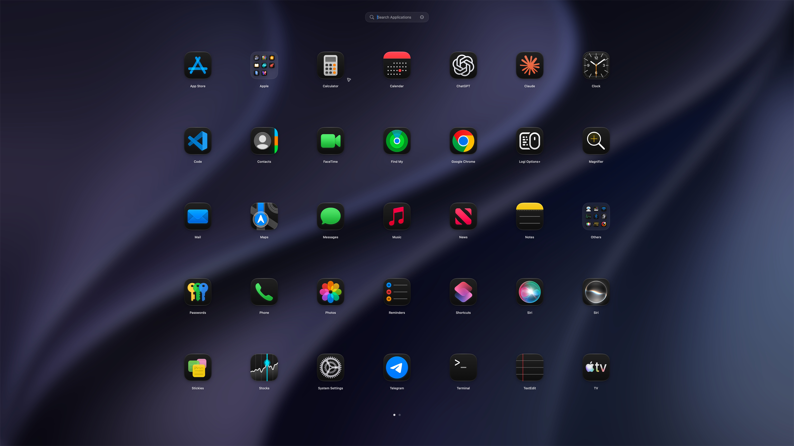
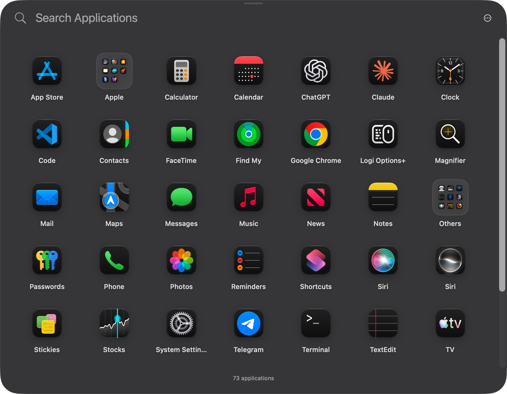
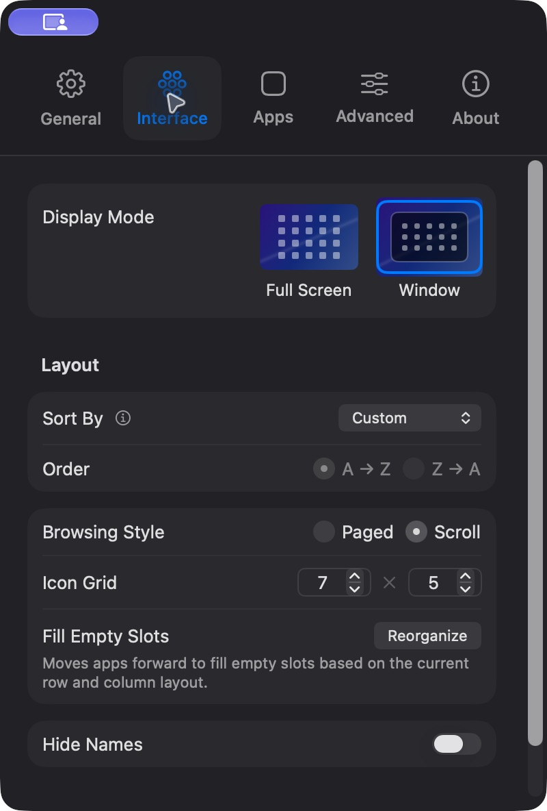

# OpenLaunchpad

A native, open-source application launcher for **macOS 26 and macOS 27**. Built with SwiftUI, AppKit, and native Liquid Glass. MIT licensed, offline, no activation, no telemetry, no paid feature gates.

Independent implementation inspired by the classic Launchpad workflow and the public LaunchOS feature descriptions. No LaunchOS code, binaries, branding, or artwork are included. Not affiliated with Apple or Remix Design.



## Screenshots

Real screenshots of OpenLaunchpad running on macOS 27. App icons and wallpaper belong to their respective owners and are shown as part of the running desktop application.

| Movable window with vertical scrolling | Native Interface settings |
|---|---|
|  |  |

**Free features:** fullscreen and movable window modes, app search, folders, drag-and-drop organization, horizontal pages or vertical scrolling, configurable activation, layout backups, profiles, and appearance controls. No subscriptions or premium unlocks.

## Build and run

Requires macOS 26+, Swift 6.2+, and the macOS 26+ SDK (Xcode or Command Line Tools). No third-party dependencies or package downloads.

```sh
git clone https://github.com/aadityaraaz/OpenLaunchpad.git
cd OpenLaunchpad
make app
open dist/OpenLaunchpad.app
```

The bundled app is ad-hoc signed for local development. `make app` builds an optimized release executable for the current machine. `./scripts/build-app.sh debug` builds a debug bundle. Drag the resulting application to your Applications folder and Dock if desired.

For development:

```sh
swift run OpenLaunchpad
make test
```

The checks use a standalone executable instead of XCTest/Swift Testing, so they also run with Apple's Command Line Tools, which do not ship those test frameworks. `swift test` is not this project's test command.

## Features

- Real application discovery in `/Applications`, `/System/Applications`, and `~/Applications`; custom directories, external drives, alias resolution, path deduplication, and exclusion of nested helper apps.
- Native app launching with system icons. Last-opened timestamps track launches made through OpenLaunchpad.
- Instant ranked search across original names and aliases, substrings, initials, camel case, abbreviations, accents, full pinyin, and pinyin initials.
- Native vertical scrolling by default, with momentum and lazy app rendering; fullscreen hides the scrollbar. Optional horizontal pages retain mounted icon views and use 0.24-second sliding transitions; mouse wheel and trackpad paging, mouse side buttons, keyboard navigation, page dots, and drag paging. Reduce Motion is respected.
- Manual reordering, icon-center drops to create or merge folders, folder dissolution, folder renaming, and movement across pages with persistent empty slots.
- ⌘ click or drag selection; batch ordering, folder creation, moving, hiding, and restoration. Organize mode makes selection possible without a modifier.
- Drag apps into the Dock using native file-URL drag data.
- Favorites strip, named layout profiles, and 30-step undo/redo for organization changes.
- Optional hidden-app search, app information, and an explicit Add to Dock action.
- Sort ascending or descending by name, date added, last opened, or icon color; combine sorting, Apple/folder placement, and ungrouping for current, all, or selected pages.
- App aliases, hide/restore, Finder reveal, folder and page context menus.
- Clean uninstall preview: move the application and selected, exact bundle-identifier matches in the user's Library to Trash. System apps and running apps are protected. Containers are unchecked by default.
- Move the window by dragging its top grip or footer; position is remembered across relaunches. Clicking outside hides it.
- Fullscreen and window modes; pointer/main/active display choice; optional Dock hiding; delayed return to the first page.
- Configurable global shortcut, optional F4 registration, menu bar and Dock activation, hot corners with delay and external-corner filtering.
- **Experimental, opt-in global 3/4/5-finger pinch/spread gestures**, with progress-driven opacity and cancellation. A private trackpad bridge is isolated and dynamically loaded; public APIs remain the default.
- Classic LaunchOS-style search/grid/folder interface and five-tab settings, plus an optional Workspace interface.
- Native Liquid Glass controls, current desktop wallpaper or a glass background, blur/material controls, automatic system light/dark appearance, explicit light/dark overrides, monochrome/tinted icon treatments, and separate app/folder labels.
- Cached wallpaper blur and local aerial wallpaper stills keep expensive image processing outside scrolling animations. Animated wallpaper playback is not included.
- Default macOS Apps logo when available, including native light/dark/tint icon variants through the system asset catalog; generated fallback on other hosts and an optional original rocket logo. Apple icon resources are read from the build machine and are not committed to this repository or covered by the project's MIT license. Dock icon appearance follows macOS icon settings, separately from app-only UI overrides.
- JSON layout export/restore and read-only legacy Launchpad SQLite import; atomic local persistence with recovery copy on corrupted input.
- App rescanning every 30 seconds, on volume changes and wake; unchanged scans preserve layout and icon caches, with background icon prefetch; disconnected custom-source layouts retained.
- Ellipsis menu with sort direction, window/fullscreen, browsing style, layout actions, profiles, undo/redo, update checking, restart, and quit.
- Optional login item registration through `SMAppService`.

## Controls

| Action | Control |
|---|---|
| Open / close globally | ⌃⌥Space, configurable in Settings |
| Search | Type immediately, or ⌘K |
| Navigate | Arrow keys |
| Change page | ⌘← / ⌘→, swipe, wheel, or page dots |
| Open app / folder | Return |
| Select multiple | ⌘ click, or Organize mode |
| Create folder | Drop on the center of another icon |
| Reorder | Drop beside an icon |
| Close / clear / back | Esc |
| Undo / redo organization | ⌘Z / ⇧⌘Z |
| Settings | ⌘, |
| Quit | ⌘Q |

Right-click the menu bar icon for settings, refresh, and quit. Closing the launcher leaves the app running for global activation. Pass `--background` to start without displaying the launcher.

## Data and permissions

Your library is stored at `~/Library/Application Support/OpenLaunchpad/library.json`. Backups contain installed application names and paths; keep them private if needed. Imported backup paths are remapped to locally discovered apps before use.

Basic browsing, launch, shortcuts, and hot corners do not request broad system permissions. F4 registration depends on your keyboard mapping and can conflict with Spotlight; Fn–F4 may be required. Experimental trackpad input may require Input Monitoring or Device Control and Data Access on your OS version. The app reports unavailable trackpad support and never changes system permissions or suppresses system gestures.

Uninstall never searches for generic app-name matches. It lists exact matches under Preferences, Caches, Application Support, Saved Application State, HTTPStorages, WebKit, and Containers. Files inaccessible without additional permission are not claimed as removed. Everything is moved to Trash after explicit in-app review; no privileged helper is installed.

## Status and limits

This is a working **0.1 development release**, not a certified feature-for-feature replacement. See the [installed LaunchOS audit](docs/LAUNCHOS-AUDIT.md), [feature coverage](docs/FEATURES.md), and [validation](docs/VALIDATION.md).

Global gesture recognition is implemented but still needs testing across built-in and external trackpads, wake/hot-plug, and different keyboard/system gesture mappings. The undocumented interface may change in macOS updates. Paging uses the scroll direction delivered by macOS; an optional Reverse paging direction setting reverses it locally. App-grid icon style changes use `NSWorkspace` plus cache refresh; integration with every OS tint mode is not complete. The default launcher bundle icon uses macOS's native appearance variants when its local system catalog is available, but a full system light/dark/tint cycle has not been visually certified. Background wallpaper uses a still image, not animated wallpaper playback; per-display aerial overrides are not resolved. No measured FPS or pixel-perfect equivalence claim is made. The UI is currently English. Automatic update delivery, Developer ID signing, and notarization still need release infrastructure and maintainer credentials; manual version checks support a configured HTTPS release feed; downloaded releases remain subject to user review. See [release feed format](docs/UPDATES.md).

## Source map

- `Sources/LauncherCore`: layout invariants, backup models, search, and gesture recognition.
- `Sources/OpenLaunchpad`: native views, application lifecycle, app scanning, shortcuts, imports, persistence, and conservative uninstallation.
- `Sources/TrackpadBridge`: optional runtime-loaded private multitouch ABI bridge.
- `Tests/LauncherCoreTests`: dependency-free regression executable.
- `scripts`: build, launcher icon generation, tests, and public website audit.

## Website research

The public sitemap contained **155 pages**, all fetched successfully on October 10, 2026. The audit covers feature pages, homepage/pricing, FAQs, release notes, comparisons, articles, marketing pages, policies, and translations. [Audit records](docs/website-audit.json) contain page URLs, status, titles, and topic matches; full copyrighted page bodies are not stored. The installed LaunchOS application was also opened to inspect the launcher, folders, menus, and all settings tabs. Its opaque `.launchos` backup format is not imported; use this project’s JSON backups or legacy native SQLite migration. The implementation checklist draws primarily from the feature page, homepage, and v2.4.0 release notes.

## Contributing

Run `make test` and `make app` before submitting changes. Keep layout invariants in LauncherCore and system integrations in the native layer. Changes to the private bridge must remain opt-in, fail gracefully, and include hardware/OS validation notes. Use synthetic applications and temporary directories when testing removal; never automate uninstallation of real user applications.

Licensed under [MIT](LICENSE).
